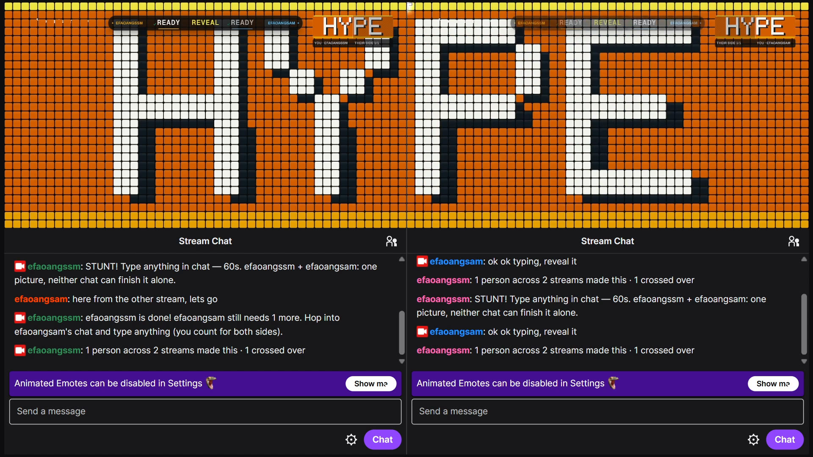
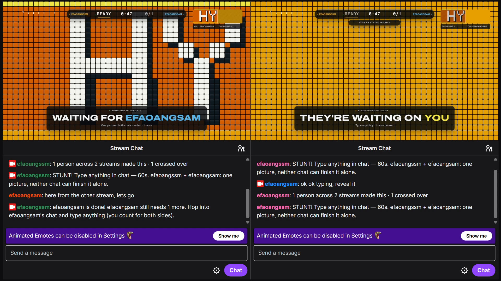
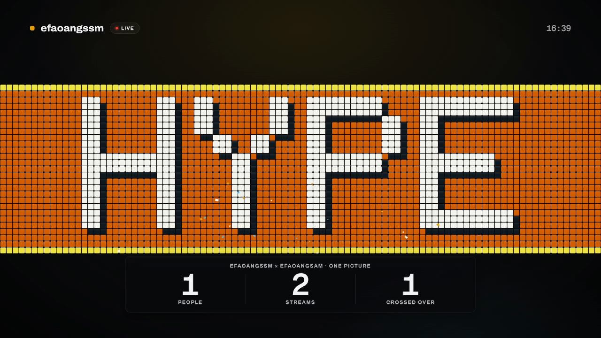
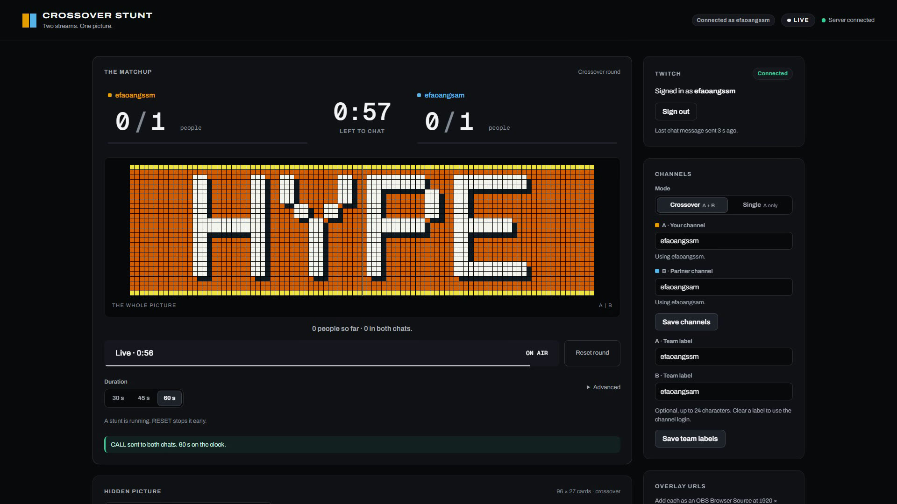

# Crossover Stunt



**Two streams. One picture.** Two Twitch communities each refine one half of a hidden picture, live on stream. Every distinct person who types anything in their channel flips the stadium cards on their half one step closer to the image. Neither chat can finish alone: the final detail only appears in a joint reveal once **both** sides reach their quorum. Single-channel **Card Stunt** is the daily-use fallback. Built with **OpenAI Codex** for the Codex x TwitchCon Hackathon.

**Status.** The whole stunt runs end to end in the credential-free SIMULATED demo: pure engine, server, both overlays, control panel and the Playwright seam test. An operator-reported live check with OBS recordings on 2026-11-01, 16:35–16:43 Chile time (UTC−3), confirmed the v3 HUD corrections on both real Twitch channels in OBS 33. Large real crowds and a real partner tunnel remain unverified. See [what is verified](#tests-and-evidence).

The demo video and submission are on the project's Devpost page.

## Quickstart for judges (no Twitch, no OBS)

Requires **Node 24+** and **pnpm 12.5.1**. No Twitch account, Client ID, secret or API key is needed:

```powershell
pnpm install
pnpm demo --autoplay
```

Then open these in a Chromium-based browser (side by side works best):

- [Overlay A](http://127.0.0.1:3000/overlay/a) and [Overlay B](http://127.0.0.1:3000/overlay/b) — the two stream overlays (transparent 1920×1080; the cards are the picture).
- [Control panel](http://127.0.0.1:3000/control) — picture, duration, live matchup, **Call the stunt** and **Reset round**. Quorum settings are under **Advanced**.
- [SIMULATED injector](http://127.0.0.1:3000/dev) — add 5, 25, 300 or 3000 virtual people per side (the seed advances after each send, so every click brings new people). It does not stop autoplay.

`--autoplay` loops three scripted rounds (about 25 s each on average):

1. **Crossover** — HYPE (HY | PE across the seam). A fills up first and shows `WAITING FOR RIGHT STAND`; B catches up; the zipper closes the seam and one wave crosses from A into B, with confetti, a synthesized crowd roar and the caption `[crowd roars]`.
2. **So close** — GG. B stalls at 9/12 and the round times out with `SO CLOSE`.
3. **Single** — GG Card Stunt on overlay A only.

To drive a round yourself, click **Reset round**, then **Confirm reset**. Choose a picture and duration; open **Advanced** to change the minimum people, share of recent chatters or fixed quorum. Click **Call the stunt**, then add people with the injector. Calling a stunt, confirming a reset or choosing a showcase stops autoplay (plain `pnpm demo` starts without autoplay).

Everything virtual is labeled **SIMULATED** on screen and nothing is sent to Twitch in demo mode. A normal browser shows a small "Click to enable sound" chip; OBS hides the chip and may allow autoplay, which still needs a real OBS check before going live. Stop the server with **Ctrl+C**. If port 3000 is busy, use another one (PowerShell: `$env:PORT=3001; pnpm demo --autoplay`, or `PORT=3001` in `.env`) and change the port in the links above.

## How it works

| Waiting on the other chat                                                                                                                                   | Stats finale                                                                                                                                        | Control panel                                                                                                                               |
| ----------------------------------------------------------------------------------------------------------------------------------------------------------- | --------------------------------------------------------------------------------------------------------------------------------------------------- | ------------------------------------------------------------------------------------------------------------------------------------------- |
|  |  |  |

Operator-supplied Twitch/OBS images and live control-panel capture.

- **Picture.** The control panel turns a preset, 1–2 lines of text (built-in 5×7 pixel font) or an uploaded image into palette indices on a 96×27 card grid (48×27 per overlay, 40 px cards; 8 colorblind-friendly colors).
- **Refinement.** On CALL the server builds one deterministic greedy quadtree plan per side: each step splits the block with the largest color error. Each side's progress is `participants / quorum`; the overlay shows the matching number of steps. The final detail (about 20 % of the steps, and at least one split for a non-uniform picture) stays hidden until the joint reveal.
- **Quorum.** Each side's target is frozen at CALL from distinct recent chatters: `max(3, ceil(0.4 × chatters in the previous 5 minutes))`, or a fixed per-side number. A person counts once per side per round, so spam and duplicate deliveries add nothing.
- **Sync.** The server owns timing. Overlays get the round plans and ≤ 10 Hz aggregate snapshots over a WebSocket, fall back to HTTP polling if it drops, and schedule the reveal from server timestamps with a measured clock offset, so A and B flip in lockstep and a reload never replays confetti.
- **Privacy.** Overlays only ever receive aggregate counts and the picture. No chat text, usernames, chatter IDs or emotes leave the server.

## Live setup (Twitch)

1. Verify your Twitch email and enable 2FA. In the [developer console](https://dev.twitch.tv/console/apps) register an application with client type **Public**. If a redirect URL is required, use `http://localhost:3000`; the Device Code flow does not use it. Do **not** create a client secret. See [registration](https://dev.twitch.tv/docs/authentication/register-app/) and the [Device Code flow](https://dev.twitch.tv/docs/authentication/getting-tokens-oauth/#device-code-grant-flow).
2. Create `.env` from the example and set only the Client ID (no quotes):

   ```powershell
   Copy-Item .env.example .env
   # then edit .env: TWITCH_CLIENT_ID=<your client id>
   ```

3. Start the live server with `pnpm build` then `pnpm start`. Use that for live sessions and recordings: `pnpm dev` (watch mode, for development) restarts the server whenever a file under `src/` or `.env` is saved, which loses the running round, channel B and the partner link. Without `TWITCH_CLIENT_ID` the server still starts and the control panel shows status `signed-out` with setup help.
4. Open [/control](http://127.0.0.1:3000/control) and click **Connect Twitch**. Enter the code shown at the Twitch activation page while signed in as the broadcaster. Do this with the control panel off stream: whoever redeems the code first links their account. The code stays masked until you press **Show**, the activation link already carries it, and **Signed in as** must show the broadcaster before a CALL. The app requests `user:read:chat user:write:chat`. Your channel becomes side **A** automatically. Tokens stay on this PC in `data/tokens.json` (gitignored, owner-only permissions where supported); **Sign out** deletes them.
5. Enter the partner's login as channel **B** and click **Save channels** (logins are resolved to user IDs through Helix). Choose **Crossover** (A + B) or **Single** (A only). Channels live in memory: after any server restart, enter B again (A reconnects automatically). If Twitch refuses or revokes only channel B (for example, your account is banned in the partner's chat), the app drops B, keeps counting channel A (single mode works) and explains why on the Twitch card.
   Use **Team label** for TEAM ORANGE / TEAM BLUE (up to 24 characters), then **Save team labels**.
   Labels update overlays immediately and survive channel saves and Twitch reconnects in this server
   session. Clear a label to follow the channel login; a server restart clears the overrides.
   Local automation can POST `{ "A": "...", "B": "..." }` to `/api/labels`.

6. Pick a picture (crossover defaults to **A + B** using both channel names; **HEART** and **FACE** remain available) and a duration (30/45/60 s). Open **Advanced** if you want to change quorum settings, then click **Call the stunt**. The button is enabled once the Twitch card shows **Connected**; without EventSub nobody would be counted. The app posts the prompt to the required chats, the summary on the reveal (`23 people across 2 streams made this · 4 crossed over`) and `SO CLOSE …` on timeout. The control panel shows whether Twitch accepted or dropped each message; a prompt repeated within 30 s gets a `(take 2)` suffix because Twitch drops identical messages. Messages from your own account never count. Chat counts until the server deadline, but viewers see the stream a few seconds late: add `latencyMs=3000` (about your stream latency) to the overlay URLs so the on-stream countdown reaches 0:00 before the deadline instead of after it.

The broadcast package uses matte paper cards, a shared-clock stadium wave and quiet glass lower thirds. Both teams appear in the score bug; the finale counts PEOPLE, STREAMS and CROSSED OVER. The control panel puts the matchup and chosen picture first, with quorum settings under **Advanced**.

During a CALL, **TYPE ANYTHING IN CHAT** becomes a persistent reminder until your side is ready.
The lagging side sees **THEY'RE WAITING ON YOU** with the exact number still needed. The ready
chat gets one invitation to help the other side. Known bots (including Nightbot, StreamElements,
Streamlabs, Fossabot and Moobot) never contribute or raise the baseline; add extra comma-separated
bot logins with `IGNORED_CHATTERS`. Logins are stripped before engine ingress and never reach overlays.

After the shared wave, **UNITE** brings the whole picture into a central band on each stream.
Titles report people across **2 STREAMS** and the crossover count. Cards retire about **18 seconds
after reveal**, returning the stream to view while the server stays complete. Use `unite=0` for
separate halves or `hold=1` to retain the picture until RESET/new CALL. Muted and reduced-motion
modes preserve the same states.

## OBS setup

Add a **Browser** source, width **1920**, height **1080**, URL `http://127.0.0.1:3000/overlay/a` on stream A and `/overlay/b` on stream B. The page is transparent: put it above your game/camera. Tick "Control audio via OBS" if you want the roar on its own mixer channel (required with two OBS instances, see below). The overlay also works muted (captions and banners tell the story). Before recording, open the source once with `debug=1` and check that it reads `rm off`: with Windows "Animation effects" turned off Chromium reports reduced motion, and `reducedMotion=0` forces the full choreography.

To run both streams from one Windows PC, create profiles and scene collections named `A` and `B`, then start two OBS instances from the OBS program folder ([launch parameters](https://obsproject.com/kb/launch-parameters)):

```text
obs64.exe --multi --profile A --collection A
obs64.exe --multi --profile B --collection B
```

With two instances on one PC, tick **Control audio via OBS** on both browser sources. Otherwise each roar plays on the default Windows output and both instances' Desktop Audio record both roars. To hear it yourself, use Advanced Audio Properties → "Monitor and Output" with a monitoring device that neither instance captures as Desktop Audio.

**Partner on another PC.** Install [cloudflared](https://developers.cloudflare.com/cloudflare-one/networks/connectors/cloudflare-tunnel/do-more-with-tunnels/trycloudflare/) (no account needed for quick tunnels; PowerShell: `winget install Cloudflare.cloudflared`), start the server from a **new** terminal so it sees the updated PATH, then click **Start sharing** in the control panel or run `pnpm share` in a second terminal. Send the partner the printed `https://….trycloudflare.com/overlay/b?room=TOKEN` URL privately; they add it as their Browser source. Through the tunnel only overlay B, its assets, the snapshot and its WebSocket are reachable, read-only, and only with the room token (a fresh random token per server start; it is not a Twitch credential). `pnpm share --stop` or **Stop sharing** closes the tunnel. Press **RESET** before Stop sharing or Ctrl+C. Any server restart (including `pnpm dev` reloading on save) creates a new tunnel URL and room token: click Start sharing again, send the new link and have the partner update their Browser source; the current round is lost. If an overlay loses the server for 15 s it hides the cards instead of freezing them, and shows them again when the link returns (`debug=1` reads `lost`, or `forbidden` for an expired partner link).

Overlay URL options: `mute=1` (captions only), `reducedMotion=1` / `reducedMotion=0` (force reduced / full motion; without it the OS setting decides), `delayMs=<0–60000>` (delay every scheduled moment to line up two streams with different latency), `latencyMs=<0–10000>` (end the on-stream countdown that much early so viewers behind the stream delay still type in time), `debug=1` (fps, clock offset, transport, reduced motion and an inspection hook), `room=<token>` (partner URL, added for you).

Choose **On-stream layout** in the control panel. Copy includes the selected layout on A,
local B and partner B URLs while preserving the private room token:

| Choice               | URL options               | Composition                                                |
| -------------------- | ------------------------- | ---------------------------------------------------------- |
| Full                 | No layout parameters      | Original full-size overlay                                 |
| Facecam bottom right | `cutout=1440,700,440,340` | Transparent camera hole with a neutral hairline border     |
| Facecam bottom left  | `cutout=40,700,440,340`   | The same hole in the other corner                          |
| Seam fit             | `fit=seam&scale=0.62`     | Smaller halves meet at the stream edges; UNITE is disabled |

Seam scale is clamped to 0.4-0.9. Custom cutout coordinates use the 1920x1080 canvas; invalid
rectangles are ignored and valid ones clip to its bounds. Participation banners stay clear of the
facecam presets, and the compact UNITE title moves above the picture band. The full-frame
layout was checked live in OBS on two Twitch streams; the facecam and seam layouts were checked in
headless Chromium only.

## Commands

| Command                              | Purpose                                                                                     |
| ------------------------------------ | ------------------------------------------------------------------------------------------- |
| `pnpm demo` / `pnpm demo --autoplay` | Credential-free SIMULATED mode (injector at `/dev`); `--autoplay` loops the showcase rounds |
| `pnpm dev`                           | Live mode with watch, for development (restarts on every save); needs `TWITCH_CLIENT_ID`    |
| `pnpm build` then `pnpm start`       | Compile to `dist/` and run it (keep `public/` alongside); use this for live sessions        |
| `pnpm share` / `pnpm share --stop`   | Open / close the cloudflared partner tunnel on the running server (`PORT` from `.env`)      |
| `pnpm typecheck`                     | Strict TypeScript check                                                                     |
| `pnpm test` / `pnpm test:watch`      | Vitest suites, including fast-check properties                                              |
| `pnpm lint` / `pnpm format`          | Prettier check / write                                                                      |
| `pnpm verify:server`                 | Start, HTTP/WS smoke and stop the demo and live servers on ephemeral ports                  |
| `pnpm browsers:install`              | One-time Chromium download into the ignored `.cache/`                                       |
| `pnpm test:e2e` (`--project=demo` …) | Playwright: real demo end to end, isolated overlay timeline, control panel (see below)      |

pnpm only allows esbuild's install script (`pnpm-workspace.yaml`). No global installs are needed. Browser binaries, screenshots, `dist/` and `data/` are generated and ignored.

## Tests and evidence

- **Vitest** (`pnpm test`): engine reducer and quadtree, including fast-check properties (spam and duplicate invariance, deadline boundary, quorum freeze, reveal gating, immutability, deterministic replay, exact tiling); runtime adapter; HTTP/WS server, access model and room token; chat announcements; showcase scripts; Twitch module (Device Code polling, refresh, EventSub welcome/subscribe/keepalive/reconnect, Shared Chat dedupe, send queue) against an injected `fetch` and a local `ws` server; control-panel artwork/pixel font, bot exclusion and composition parsing.
- **Playwright** (`pnpm test:e2e`, Chromium, one config with three projects):
  - `demo` starts `pnpm demo` on port 3100 and checks real end-to-end behavior: showcase crossover (cards drawn, WAITING, joint wave, complete), so-close (timeout without chat, fade to transparent), single mode, A/B captures at n = 5 / 25 / 300 / 3000 after a CALL, the **seam test** (A and B at the same progress: the cards on columns 47|48 must equal the plan's leaves, checked through a `?debug=1` hook and by canvas pixels, before and after the reveal), polling fallback, and the control panel driving CALL/RESET.
  - `overlay-render` runs the overlay alone with a mocked socket and a paused clock: deterministic timeline captures, reduced motion, `delayMs`, late joiners, long labels, CTA/waiting cues, UNITE, retirement/hold, facecam/seam layouts, a joint A|B view and frame pacing.
  - `control` runs the control panel and dev page against an in-memory API mock, including team labels and layout URL copying.
  - Captures go to `test-results/e2e/`, `test-results/overlay/` and `test-results/control/` (ignored).
- **Verified live (2026-10-31 and 2026-11-01, Windows 11, OBS 33):** a Public app with the Device Code flow and a real broadcaster account; stored tokens reused after a server restart; **two real channels on one EventSub WebSocket** (efaoangssm + efaoangsam); Helix bot messages in both chats; OBS browser sources rendering overlays A and B on two simultaneous Twitch streams (720p30, 0 dropped stream frames), watched in the twitch.tv players; crossover, single-channel and timed-out (SO CLOSE) rounds; the roar captured in the OBS recordings. Evidence: the demo video (twitch.tv players and both chats on screen). The live tests used our two channels and one viewer account (one person per side).
- **Operator-reported v3 HUD recheck (2026-11-01, 16:35–16:43 Chile time, UTC−3):** efaoangssm and efaoangsam streamed again from OBS 33 with real chats: two crossover HYPE rounds, one single-channel GG round and one SO CLOSE round. The operator reports OBS recordings showing `WAITING FOR EFAOANGSAM` in full with the blue name, `READY · REVEAL · READY` during the wave, and the larger HUD type. This is operator-reported evidence backed by OBS recordings; OpenAI Codex did not observe the live check itself.
- **Not verified yet:** real crowds of many distinct people, refresh-token rotation, EventSub reconnect/revocation, Shared Chat, dropped messages, a real cloudflared tunnel and the partner's room cookie inside OBS, and OBS frame rate under heavy load. Per-phase Chromium frame-pacing measurements for this redesign are recorded in CODEX_LOG; they are regression signals, not proof of OBS performance or a sustained 60 fps claim.

[docs/CODEX_LOG.md](docs/CODEX_LOG.md) records the Codex sessions logged so far and the evidence actually gathered in them. Its first entry is the repository scaffold session: its "Deliberately unfinished" list describes the state at the end of that session, not the current one (current status and verification are in this section and in [docs/SPEC.md](docs/SPEC.md)).

## Project map

```text
src/engine/       Pure reducer, quorum window, deterministic quadtree planner (no IO, no clock)
src/twitch/       Device Code auth, token store, EventSub WebSocket, Helix users/chat, Shared Chat
src/server/       HTTP routes, access model + room token, runtime adapter, WS hub, share tunnel
src/shared/       Versioned aggregate-only overlay protocol (v2)
src/sim/          Seeded virtual crowds and scripted showcase rounds (SIMULATED only)
public/overlay/   Plain JS Canvas2D + Web Audio overlay (no build step)
public/control/   Control panel, pixel font and artwork builder; public/dev/ injector
test/             Vitest suites; test/e2e/ Playwright projects
scripts/          Server smoke, Playwright wrapper, share CLI
.agents/skills/   Codex workflows: twitch-eventsub, overlay-visual-check, stunt-engine
docs/             SPEC (scope + status), DESIGN (contracts), TWITCH_NOTES, CODEX_LOG
```

Read [AGENTS.md](AGENTS.md), [docs/SPEC.md](docs/SPEC.md) and [docs/DESIGN.md](docs/DESIGN.md) before changing behavior.

## Innovation

Most chat games run inside one community. Here two communities share one picture that neither can see whole: each overlay shows its own half large plus a minimap of the partner's progress (`THEIR SIDE 7/12`), a finished side visibly waits for the other, and success is one synchronized moment on both streams. The operator-reported OBS 33 recheck on 2026-11-01 confirmed the v3 HUD corrections across two crossover HYPE rounds, a single GG round and a SO CLOSE round, with OBS recordings as evidence.

## Impact

Participation is "type anything": no commands, points, bits or subscriptions, and lurkers stay anonymous because nothing from chat is ever rendered. Each side's quorum adapts to its own recent chat, so a small channel can stunt with a big one. Single-channel Card Stunt works every day without a partner. Observations from real sessions are still to be added.

## Technological implementation and Codex

A pure, property-tested engine; one server-owned clock with timestamped, reload-safe effects; WebSocket plus polling fallback; Shared Chat-aware deduplication; a pixel-level seam test across two independent overlays; and a read-only, room-token partner tunnel. Built with OpenAI Codex using the repository skills in `.agents/skills/`.

## Design

Archivo headlines and labels pair with Geist Mono data. The score bug uses rolling tabular digits; glass lower-thirds keep one accent. Matte stadium cards make a real flip with a face swap at the midpoint, followed by a shared-clock stadium wave that crosses the A|B seam. A stats end card finishes the reveal. Reduced motion replaces physical movement with fades and brightness. The control panel leads with the matchup and picture preview, one **Call the stunt** action and **Advanced** quorum controls.

## License

[MIT](LICENSE), © 2026 Crossover Stunt authors. No external artwork or music is bundled; the roar is synthesized at runtime. The self-hosted broadcast fonts are Archivo (The Archivo Project Authors / Omnibus-Type, 2020) and Geist Mono (The Geist Project Authors, 2024), both under the SIL Open Font License 1.1. Licenses ship beside the fonts: [Archivo OFL](public/fonts/Archivo-OFL.txt) and [Geist Mono OFL](public/fonts/GeistMono-OFL.txt). No font requests leave this server.
